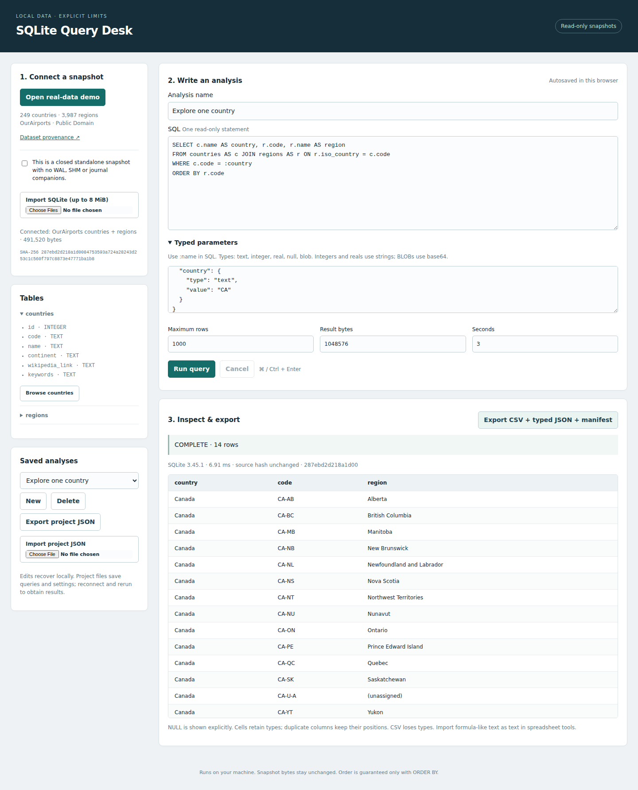

# SQLite Query Desk

A local browser workbench for inspecting a SQLite snapshot, saving typed analyses, and exporting results whose source, query, limits, completion state and bytes can be checked independently.

## Launch

Install Python **3.11 or newer**, including its standard `sqlite3` module, then run:

```sh
./launch.sh
```

Open **http://127.0.0.1:4173** and select **Open real-data demo**. No Python packages, accounts, network requests, or frontend build are required. Use `./launch.sh --port 4180` for another port. On Windows, use `python -m desk.server` from the project directory instead of the shell script. Linux execution is tested; macOS and Windows are not yet exercised.

The included OurAirports snapshot contains **249 countries and 3,987 regions**. Choose **Regions by country** to compare administrative-region counts, **Explore one country** to join a country to its regions (edit the `country` text parameter), or **Continental summary** for grouped counts. These are community geographic reference records, not guaranteed current administrative boundaries. The source includes pseudo-regions such as unassigned regions; counts describe this dataset, not a country's official subdivision count.



## Your database

1. Close the source application and produce a consistent standalone copy using its backup/export facility. The copy must be in SQLite DELETE journal mode, with **no `-wal`, `-shm`, or `-journal` companions**. Do not copy only the main file of a live WAL database. If conversion is needed, perform it on a separate copy using a trusted SQLite tool, never on your only original.
2. Confirm the snapshot checkbox and import the `.sqlite`/`.db` file (up to 8 MiB). The application checks the SQLite header and refuses WAL-mode files. Browser file APIs cannot discover unselected companions or prove a source application is closed; the confirmation is an essential precondition.
3. Expand a table to inspect columns, or select **Browse** to prepare a bounded query. Use `ORDER BY` when row order matters.
4. Edit SQL and typed parameters, set limits, and run. **Cancel** stops the worker process. Read the completion status before interpreting output.
5. Download the export ZIP. It contains `results.csv`, `results.json`, and `manifest.json`. Partial exports require acknowledgment; failed results cannot be exported.

The server holds one imported snapshot and one current result. Reconnecting replaces both. Only the immutable uploaded copy is queried; the app has no source-path API. The file you selected is never opened for writing. Query results contain before/after snapshot hash verification; the included tests additionally compare the original bytes.

## Recovery and portability

Edits to all named queries, typed parameter JSON, selected query, execution settings, and the last source identity are stored in this browser's local storage. Use **Export project JSON** for a durable backup. Reloading or importing a project always requires explicit database reconnection and rerun, even when hashes match. If different bytes are connected, the app shows the change and discards the current result. Database bytes and results are **not** persisted in project files. Use result ZIPs to preserve historical results with their exact source and execution metadata.

The app is a single-user, single-tab workbench. Multiple tabs share the server's one snapshot/result, and another tab can invalidate a job. A source-hash guard rejects execution against an unexpected snapshot. Browser storage is origin-specific, may be cleared, and is not encrypted. Local SQL and database data may be sensitive; store exports accordingly.

## Verification and reproducibility

```sh
python3 -m unittest discover -s tests -v
python3 scripts/verify_demo.py
python3 scripts/build_demo.py --output /tmp/ourairports-rebuilt.sqlite
```

The independent verifier calculates expected results directly from the source CSVs with Python dictionaries and sorting, compares **every typed cell and row multiplicity**, and reopens all three frozen exports plus the browser-produced real-data export. It also checks manifest hashes and CSV correspondence. The source revision, URLs, licensing evidence, file hashes, and conversion are in [demo/provenance.json](demo/provenance.json). To reacquire exact pinned bytes, run `python3 scripts/build_demo.py --fetch --output /tmp/ourairports-rebuilt.sqlite`. SQLite versions can change physical database bytes; source CSV hashes and query values are the portable reproduction target.

Browser automation uses the development-only Playwright dependency:

```sh
npm ci
npx playwright install chromium
npm run test:browser
```

The test starts its own server on a free loopback port. It retains a screenshot, project backup, result ZIPs, and a structured execution record under `results/`. See [results/independent-verification.json](results/independent-verification.json). Tests use labeled synthetic controls for error cases; all geographic demonstrations and sample exports use real public source data.

## Scope and prior work

[DB Browser for SQLite](https://sqlitebrowser.org/) already offers broad SQLite viewing and editing. This project makes no novelty claim: its narrower purpose is a small read-only workflow with explicit resource limits and verifiable exports. The policy follows SQLite's [authorizer API](https://www.sqlite.org/c3ref/set_authorizer.html), [query_only and trusted_schema pragmas](https://www.sqlite.org/pragma.html), [immutable/read-only URI semantics](https://www.sqlite.org/uri.html), and [WAL companion-file requirements](https://www.sqlite.org/wal.html).

Read [docs/formats-and-policy.md](docs/formats-and-policy.md) for exact limits, types, unsupported features, and export semantics. This is an analysis tool for trusted local snapshots, not a hosted multi-user database service or a hardened sandbox for malicious database files. Keep the Python/SQLite installation patched.
