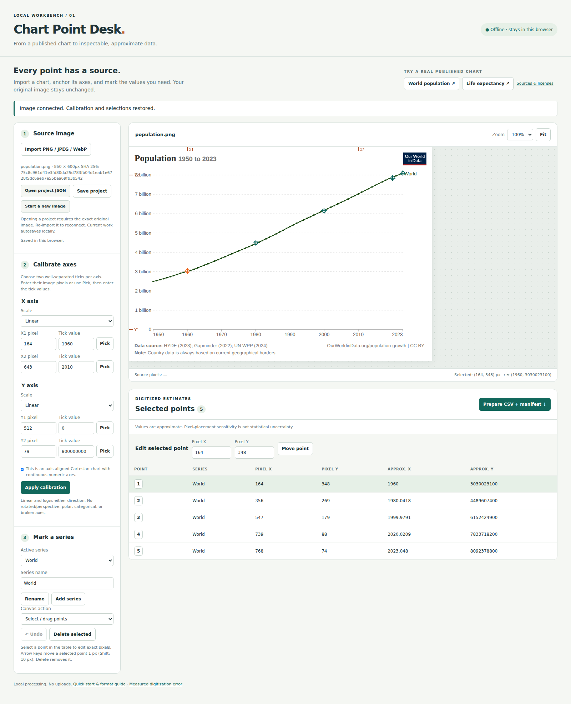

# Chart Point Desk

An offline chart-digitizing workbench: import a published plot, calibrate its axes, select and edit points, and export approximate values with their original pixel coordinates.



## Launch

Requires Python 3.10+; no installation or network access is needed to use the app:

```sh
python3 scripts/serve.py
```

Open **http://127.0.0.1:8000** in a modern desktop browser. The server binds only to your computer. Chrome/Chromium is the tested browser. Use the **World population** or **Life expectancy** buttons for a visible, editable demo using real published Our World in Data charts and measured sample selections. The app has no external runtime dependencies, uploads, analytics, or remote API calls. Keep the local server running; this is not a service-worker-installed app.

## From chart to CSV

1. Import a PNG, JPEG, or WebP image. Use **Start a new image** to replace an existing project. The imported image is never rewritten.
2. Choose **Linear** or **Logarithmic (base 10)** independently for X and Y. For each axis, enter two tick values and their source-image pixel positions. **Pick** lets you click the tick instead of typing its pixel position. Use separated anchors that bracket the points you need. Tick values may increase or decrease in image coordinates.
3. Confirm the supported geometry and **Apply calibration**. Tick values use full numerical units: enter `8000000000` for “8 billion”. Log tick values must be positive, e.g. `1` and `1000`, not their logarithms.
4. Name a series, then click the chart to add points. Add more named series when needed. Choose **Select / drag points**, or select a point in the table. Drag to move it; its numeric pixel fields allow precise changes. Arrow keys move a selected point by 1 pixel (Shift: 10). Delete removes it. **Undo** reverses up to 100 edits during the current session.
5. **Prepare CSV + manifest** creates three separate download links. Download all three: `points.csv`, `manifest.json`, and `project.json`. Keep the unchanged source image too. Any further edit invalidates the prepared links; export again.
6. Reloading recovers the image, calibration, series, and points from IndexedDB. For transfer or backup, use **Save project**. **Open project JSON** deliberately disconnects the image; import the exact original image to reconnect it. A SHA-256 mismatch rejects reconnection without altering the project.

Watch the save status. If browser storage is unavailable or full, download a project JSON. Browser storage is specific to this origin/profile, can be cleared or evicted, and is not a backup. Undo history, zoom, and current table selection are session-only.

## Supported geometry and limits

Only axis-aligned Cartesian plots with continuous numeric axes, independently linear or log10, are supported. Reversed X and/or Y directions work. Perspective distortion, rotated plots, polar plots, categorical axes, and broken axes are **not supported**; the user must verify the geometry. The application cannot infer those features from pixels.

Images: PNG/JPEG/WebP, at most 10 MiB, 10,000 pixels on either side, and 25 megapixels. Projects: at most 10 MiB, 100 series, and 10,000 points; each series label is at most 200 characters. Larger sets have not been performance-benchmarked. PDF/SVG must be rasterized separately. These limits reject invalid input; supported small examples are not evidence for every browser or maximum-size workload. Desktop pointer/keyboard use is tested; touch editing is not independently validated.

Pixels use a top-left origin, X rightward and Y downward, in the decoded image’s intrinsic dimensions. Zoom does not change stored coordinates. JPEG orientation is interpreted by the browser; use a consistently oriented PNG for cross-tool exchange. The original imported bytes are retained locally and identified by hash. They are **not embedded** in project exports. Anchor positions must be inside the image and at least one pixel apart; their values must differ. Points outside the image, nonfinite numbers, and logarithmic overflow/underflow are rejected. Extrapolation beyond anchors is permitted inside the image and can increase error.

All output values are **digitized estimates, not original measurements**. More decimal digits in an export do not imply measurement precision. Pixel-placement sensitivity is distinct from statistical uncertainty in the source data. This software does not estimate the latter.

## Export format

See [FORMAT.md](FORMAT.md). Each sample has a [CSV](samples/population.csv), [manifest](samples/population.manifest.json), and [project](samples/population.project.json). CSV order is insertion order, with a one-based order within each series. Labels are exact UTF-8 strings and CSV-quoted; when opening in spreadsheet software, import label and ID columns as **text**, so labels beginning with `=`, `+`, `-`, or `@` cannot be interpreted as formulas. Python’s `csv.DictReader` reads labels unchanged.

The separate manifest contains source-image SHA-256 and dimensions, both axes’ anchors and transformations, series, ordered points and pixel/value coordinates, approximation labeling, and SHA-256 hashes of the exact CSV and project bytes. It cannot contain a hash of itself. The project stores the editable source coordinates; calculated values are regenerated from its anchors.

## Real-input evidence

[Sources, licenses, revisions, hashes, and acquisition commands](fixtures/README.md) cover two published charts, World 1950–2023, and their available underlying numerical data. Original SVG/CSV bytes are preserved. PNGs are explicit, uncropped rasterizations of those SVGs.

The [full error report](results/accuracy.md) retains every reference comparison: **9 of 10 selections met the frozen tolerances; 1 did not**. Maximum absolute Y errors were about **53.28 million people** and **0.6513 years**. The latter missed the 0.5687-year tolerance at year 2000. The misses and the tolerances were not adjusted away. This is a small operator-placement experiment, not a general accuracy guarantee. Both real charts use linear axes; labeled synthetic controls separately cover log and reversed axes and invalid calibration.

Tests exercise the real-input browser workflow through import, tick picking, calibration, named series, point editing, dragging at zoom, undo, recovery, hash rejection/reconnection, CSV/manifest download, and reopening exported files with an independent Python parser. Browser screenshots in `results/` show the tested workbench.

## Reproduce checks

Using Node.js 20+ and Python 3.10+:

```sh
npm ci
npx playwright install chromium
npm test
npm run test:browser
python3 scripts/verify.py
python3 scripts/verify.py --exports test-results/exports
```

The app itself does not require Node or Playwright. Browser tests write fresh exports/screenshots under ignored `test-results/`; committed samples stay unchanged. Verification fails on hash, parser, coordinate, or recorded-result discrepancies. It reports the known negative result without treating a reproducible negative experiment as a software failure. **`python3 scripts/verify.py --require-tolerances` intentionally exits 1** because one frozen selection missed tolerance. No claim is made that all experimental tolerances passed.

To inspect fresh public acquisition or rasterization, use empty temporary directories as described in [fixtures/README.md](fixtures/README.md). Do not overwrite the frozen reference plan or selections after looking at errors.

## Existing work

[WebPlotDigitizer](https://github.com/automeris-io/WebPlotDigitizer) already provides extensive chart digitization capabilities. This independently implemented, deliberately smaller workbench focuses on offline manual Cartesian selection, exact-image reconnection, and inspectable exports. It makes no novelty claim and includes no WebPlotDigitizer source code.
