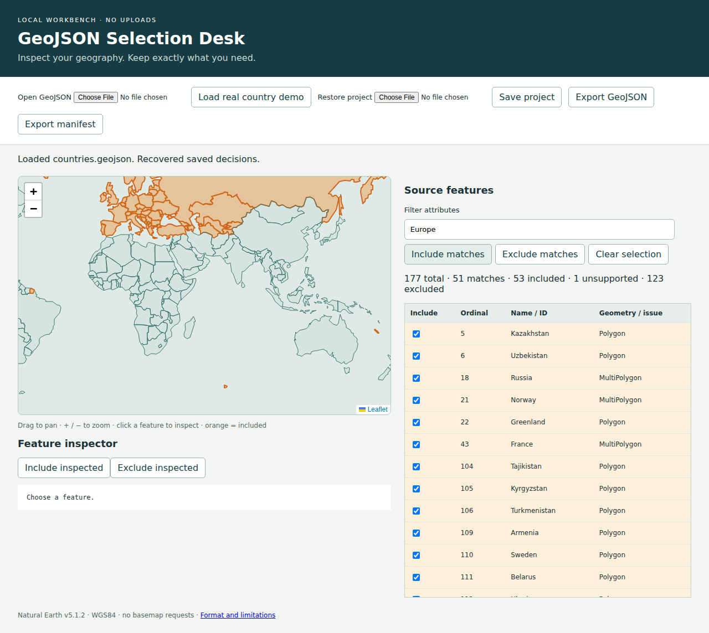

# GeoJSON Selection Desk

Inspect a local GeoJSON dataset, select source features through a linked map and attribute table, and export unchanged feature objects with a separate audit manifest. No account, uploads, remote tiles, runtime package installation, or network connection is needed.

## Launch

Requires Python 3 and a modern browser with Web Crypto (Chrome 141 tested).

```sh
./launch.sh
```

Open **http://127.0.0.1:8876/web/**. Click **Load real country demo** to inspect 177 Natural Earth countries, or open your own GeoJSON. Drag to pan, use the zoom buttons, and click a feature or table row to inspect its full properties. Check a row or use **Include inspected**. Orange features are included. Attribute filtering searches the serialized properties, case-insensitively; filtering alone does not change inclusion. **Include matches** and **Exclude matches** explicitly change all supported matching features. Unsupported rows remain visible and cannot be included; null geometries can be selected in the table.

Selections and the filter are saved in browser localStorage. After a reload, reopen the original source (or reload the demo) to recover them. The application deliberately does not retain your source file. **Save project** produces a portable decision file; on another browser, open the original GeoJSON and then **Restore project**. A SHA-256 mismatch rejects restoration, including whitespace-only changes. Browser storage is limited to the most recent source; save project files to preserve multiple projects.

Download **Export GeoJSON** and **Export manifest** before changing decisions. Both reflect the current selection. The manifest includes the source byte hash, zero-based source ordinals, filter, explicit selections, excluded ordinals, unsupported reasons, and the output byte hash. IDs are never used as row keys. Reopen the exported GeoJSON as another dataset.



## Real input and example export

The bundled public-domain [Natural Earth](https://github.com/nvkelso/natural-earth-vector) 1:110m admin-0 country dataset is pinned to `f1890d9f152c896d250a77557a5751a93d494776` (v5.1.2). Source URLs and SHA-256 hashes are in [data/provenance.json](data/provenance.json); full license evidence is in [data/LICENSE-natural-earth.md](data/LICENSE-natural-earth.md). Acquire it again with `python3 scripts/acquire.py` (network required only for acquisition). The original is retained as `countries.source.json`. Conversion removes only the legacy CRS84 declaration and serializes JSON; coordinates are not transformed. Python checks feature equivalence in the verification suite.

[Sample Europe export](results/europe.geojson) selects the exact property `CONTINENT = Europe`: 39 included, 137 excluded, 1 unsupported. [Manifest](results/europe.manifest.json) records every ordinal. Antarctica is flagged for an uncut antimeridian segment. [Independent Mapshaper rendering](results/europe.svg) projects a separate viewing copy to Robinson; the downloadable GeoJSON remains WGS84. Mapshaper reads the exported file independently of the application's Leaflet renderer. This is a static geographic view, not evidence of topological correctness.

## Supported format and limits

- RFC 7946 FeatureCollection, WGS84 longitude/latitude, Point, MultiPoint, LineString, MultiLineString, Polygon and MultiPolygon, plus null geometry. GeometryCollection and legacy CRS declarations are unsupported. Collection-level CRS rejects import; unsupported feature geometry is individually accounted for.
- Coordinates must be finite, with longitude in [-180,180], latitude in [-90,90], and 2 or 3 values per position. Rings must close and have at least 4 positions; lines need 2. Empty geometries are unsupported. Segments jumping more than 180 degrees are flagged, not wrapped or repaired. Already-cut multipart antimeridian geometry is accepted.
- No simplification, reprojection, property pruning, ID deduplication, or reordering occurs in exports. Entire supported feature objects, including their bbox and foreign members, are retained. Collection bbox and other collection metadata are omitted because they may no longer describe the subset. Feature bbox values are preserved, not used for rendering or validated for consistency.
- JSON is parsed into JavaScript binary64 numbers and reserialized. Decimal spelling and whitespace are not preserved; exact decimal arithmetic is not promised. Nonfinite values, negative zero and unsafe integer values are rejected. Use strings for large identifiers. Duplicate object keys are rejected. Topological validity (self-intersections, hole containment and winding) is not checked or repaired. Leaflet uses a Web Mercator view: polar regions are visually distorted and altitude is ignored for rendering.
- Limit: 8 MiB and 2,000 features. Complexity within a single geometry is not bounded separately; dense datasets may be slow. This is a small-dataset desk, without spatial indexing or basemap context. Imported content is rendered as text; no remote data is fetched by the application. The local server binds only loopback and serves this checkout; do not expose it publicly.

## Verification

Node 24 and Python 3 are used for development checks. Runtime is dependency-free; vendored Leaflet 1.9.4 is covered by its adjacent license.

```sh
npm ci --cache /tmp/geo-npm
npm test
npm run demo
python3 scripts/verify.py data/countries.geojson results/europe.geojson results/europe.manifest.json
npm run viewer
npm run test:browser
```

Browser tests require a Chromium executable; set `CHROME_PATH` to your installed Chrome. Alternatively run `npx playwright install chromium` to install Playwright’s test browser. Tests import real data, inspect and include a map feature, filter and select rows, recover state after reload, restore a project, download and independently verify both exports, reject a changed source, reopen exported data, and view the independently rendered SVG. Controls test polygon holes, multipart geometry, null geometry, duplicate/missing IDs, Unicode properties, malformed coordinates and unsupported geometries. The independent Python verifier compares every included feature and reconciles all source ordinals; it does not share the application parser or selection implementation.

## Existing work

[geojson.io](https://github.com/mapbox/geojson.io) provides geographic editing and viewing; [Mapshaper](https://github.com/mbloch/mapshaper) provides extensive geographic processing. This desk claims no new GIS algorithm. Its scope is a small offline selection workflow with explicit ordinal accounting. Format decisions follow [RFC 7946](https://datatracker.ietf.org/doc/html/rfc7946), especially geometry, WGS84, antimeridian cutting, bbox and numeric interoperability sections.
