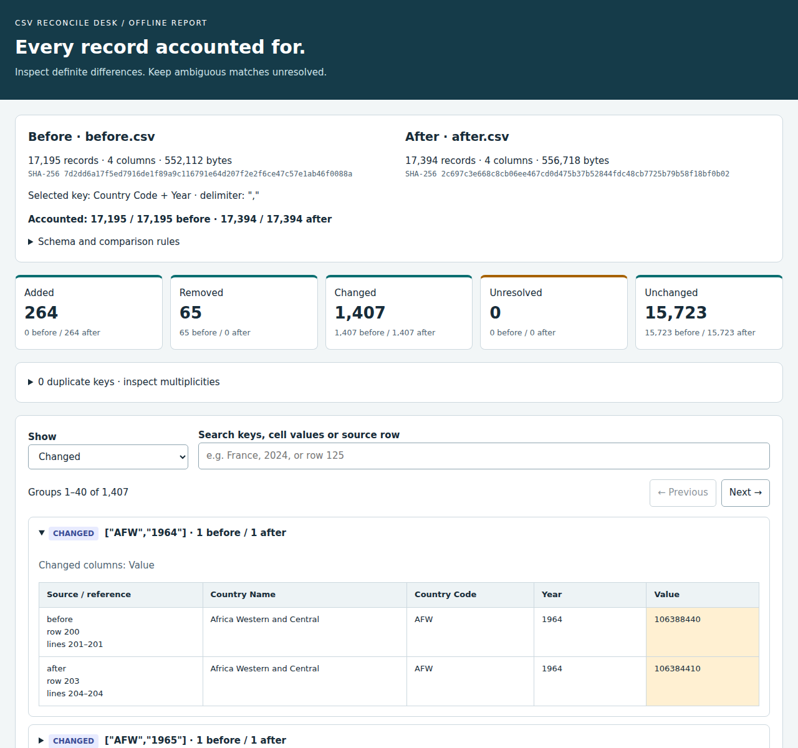

# CSV Reconcile Desk

Compare two CSV exports locally, choose the columns that identify a record, and
browse added, removed, changed and unresolved records in a standalone HTML report.
Every input record is retained with its data-row number and physical line range.
Duplicate keys never silently overwrite records or produce guessed changed pairs.

## Try the real-data demo

Requires Python 3.10 or newer. From this checkout, run:

```sh
python3 scripts/demo.py
```

Open **`demo-output/comparison.html`** in a browser. No server or internet is needed.
The script compares two bundled, complete public population dataset revisions,
checks their SHA-256 hashes, and independently verifies every result using SQLite.
It also writes `demo-output/comparison.json`. Rerunning replaces these demo outputs.
Use the status selector, search, previous/next buttons and expandable record groups
to inspect differences. Search `row 125` for a source record or `France` for a value.

The pinned revisions contain 17,195 before and 17,394 after records: **264 added,
65 removed, 1,407 changed, 15,723 unchanged, and no unresolved records** under the
composite key `Country Code` + `Year`. See [the real-data results](docs/results.md)
and [provenance and licenses](data/population/README.md).



## Install and compare your own exports

Python with `venv` and `pip` is required for installation (some Linux distributions
package them separately). The application has no runtime dependencies.

```sh
python3 -m venv .venv
.venv/bin/python -m pip install .
.venv/bin/csv-reconcile before.csv after.csv \
  --key 'Customer ID' --key 'Invoice ID' \
  --json output/comparison.json --html output/comparison.html
```

On Windows, use `.venv\Scripts\python.exe` and `.venv\Scripts\csv-reconcile.exe`.
You can also use `python3 -m csv_reconcile_desk ...` directly from this checkout
without installation. Open the resulting HTML file directly in a modern browser;
all data and assets are embedded. No data leaves your computer.

`--key` is mandatory and repeatable. Choose columns representing identity in both
exports, not a value you expect to change. Key components and values are exact,
case-sensitive strings. A changed key is an added/removed record, not a detected
rename. `--delimiter ';'` supports semicolon-delimited input; use an actual tab
character for TSV. Both files use the same delimiter. Existing outputs are
protected unless `--force` is supplied. Inputs cannot be output targets.

Exit code **0** means the comparison completed, including when differences or
unresolved records exist; **2** means invalid input or an I/O/usage error. Consult
`summary.unresolved` in JSON when unresolved records should block your workflow.
The output files are written separately: an I/O failure may leave one completed
output, so use the exit code before consuming both files.

## How matching works

1. Group records by the explicitly selected key. An empty key component makes
   that record unresolved, even if an identical record exists on the other side.
2. Within each nonempty key, cancel exactly equal records one-for-one in source
   order. This preserves duplicate multiplicity. Equal values do not establish
   individual identity among identical duplicates.
3. A residual pair is **changed** only when the original key occurred exactly
   once in each input. Changed fields are listed explicitly.
4. If residual records remain on both sides of any duplicate key, retain the
   entire residual group as **unresolved** without pairings, additions or removals.
   Even one residual record on each side stays unresolved.
5. Residual records on only one side are **added** or **removed** as a multiset
   difference. All duplicate keys and their original multiplicities are disclosed,
   including those that match completely or exist on only one side.

Every source record appears exactly once in the event list. The HTML summary
counts **event groups**, with separate before/after record totals. An unresolved
group may contain several records. The accounting totals always refer to records.

## Formats and limits

- UTF-8 CSV, with optional UTF-8 BOM, a header, double-quote escaping, quoted
  delimiters and multiline fields; LF and CRLF line endings are supported. Parsing
  follows Python's `csv` Excel dialect with strict quote-error handling.
- Duplicate or blank column names, ragged rows, blank records, NUL bytes, invalid
  UTF-8 and absent key columns are rejected. Header-only files are valid.
- No inferred keys, whitespace trimming, numeric/date conversion, case folding,
  fuzzy matches, encoding detection, spreadsheet/XLSX support or conflict resolution.
  A whitespace-only key value is a literal key, not a missing value.
- Added/removed columns are reported. An absent column differs from an empty
  string. Unique-key records with an added or removed field are changed. Column
  reordering alone does not change records. Schema changes can make duplicate
  groups unresolved because their full records no longer compare equal.
- All input and output data is held in memory. This release is intended for modest
  exports; the approximately 17,000-row-per-input demo is exercised. Large files,
  giant ambiguous groups or very wide tables may exceed memory or browser limits.
  The CSV parser's field-size limit is 128 KiB on the tested Python runtime;
  larger individual fields fail explicitly. No streaming or disk-backed mode.
- JSON has stable ordering, no timestamps or absolute paths, and is byte-identical
  for identical input bytes, basenames, selected key order and delimiter. Input
  basenames and SHA-256 hashes identify each source. See [JSON format](docs/format.md).
- The report contains the full source data, including unchanged records. Treat it
  with the same confidentiality as the original exports. It makes no network
  requests. JavaScript must be enabled; JSON is the non-browser alternative.

## Verify and develop

```sh
python3 -m unittest discover -s tests -v
python3 scripts/demo.py
```

The tests cover duplicate multiplicities and ambiguity, missing/composite keys,
quoted multiline fields, BOM/CRLF, schema changes, malformed input, deterministic
outputs, CLI safeguards and 100 seeded randomized conservation checks. The demo's
independent verifier uses SQLite joins and checks every field and source row,
without importing the comparison engine. See [browser checks](docs/testing.md)
for optional Playwright verification and installation smoke checks.

This is a focused implementation of established CSV diff ideas, not a claim of a
new reconciliation algorithm. [csv-diff](https://github.com/simonw/csv-diff) is a
related Python CLI; its [keyed loader](https://github.com/simonw/csv-diff/blob/main/csv_diff/__init__.py)
returns a dictionary keyed by identity. This project's multiset grouping, explicit
unresolved states and offline inspection report address a different requirement:
retain all source records when keys repeat.

Code is MIT licensed. Bundled public data has separate licensing and attribution.
