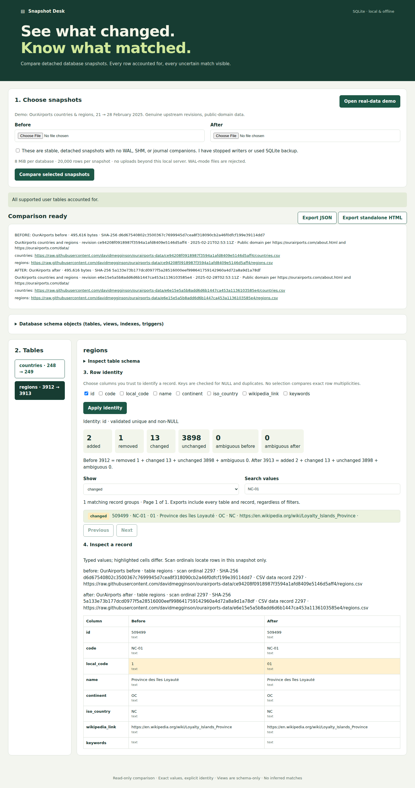

# SQLite Snapshot Desk

An offline browser application for understanding changes between two SQLite snapshots, with explicit row identity and complete accounting. Python 3.11+ with SQLite 3.37+; no runtime packages, accounts, or network connection required.

```sh
python3 app.py
```

Open **http://127.0.0.1:8765** and click **Open real-data demo**. If that port is occupied, use `python3 app.py --port 8876`. Stop with Ctrl-C. The server binds only to IPv4 loopback. On a remote machine, forward its port with SSH to use your own browser; do not expose it publicly.



## Try the real-data workflow

1. Open the demo. Select **regions**, choose **changed**, and search for **NC-01**.
2. Select the record: `local_code` changed from text `1` to text `01`. Both values, storage classes, source CSV record ordinals, revision URLs and database hashes are inspectable.
3. Try identity **code** instead of **id** and click **Apply identity**. The match assumptions change: region-code renames become additions/removals. The app does not decide which identity is appropriate for your question.
4. Navigate to **countries**, filter **added**, and inspect the upstream addition. Labels and territorial descriptions are the source's claims, not this application's.
5. Export JSON or standalone HTML. Exports include all tables and all records, regardless of the current search/page. Open the HTML with your network disconnected: navigation, filters and inspection still work. Identity is fixed in an exported report; recompute in the local app to change it.
6. To use your own snapshots, select both files, confirm they are stable detached files, and click **Compare selected snapshots**. Select identity columns explicitly; uploads start with no assumed key. Files go only to the local Python server and are deleted from its temporary directory when the request finishes.

The bundled CSVs and databases are genuine public revisions of [OurAirports](https://github.com/davidmegginson/ourairports-data), dated 2025-02-21 and 2025-02-28. Data is public domain per [OurAirports' own statement](https://ourairports.com/about.html). They are not controlled mutations. [Provenance](demo/provenance.json) records immutable revision URLs, dates, source hashes, SQLite hashes and commands. All CSV fields are imported as TEXT, preserving leading zeros, `NA`, Unicode, and empty strings. CSV data record ordinals exclude the header; they correspond to scan ordinals for this importer. No geographical correctness claim is made.

Rebuild offline, or reacquire the exact revisions and verify their hashes:

```sh
python3 scripts/build_demo.py
python3 scripts/build_demo.py --fetch
python3 scripts/verify_demo.py
```

The independent SQL oracle verifies exact CSV import and every added/removed/changed/unchanged ID, and checks that both database hashes remain unchanged. With `id` identity, results are:

| Table | Before | After | Added | Removed | Changed | Unchanged |
| --- | ---: | ---: | ---: | ---: | ---: | ---: |
| countries | 248 | 249 | 1 | 0 | 0 | 248 |
| regions | 3912 | 3913 | 2 | 1 | 13 | 3898 |

## What a match means

- **Selected identity:** one or more columns form a composite key. A group with a NULL key component or duplicate key in either snapshot is **ambiguous**, with every occurrence retained and no pairwise changes claimed. Other groups may still be compared. Key validity is displayed. Keys are never silently guessed from rowid, primary keys, or row order.
- **No identity:** exact rows are compared as multisets. Identical occurrences are unchanged, including duplicate multiplicities. If both sides have residual rows, all those residuals form an ambiguous group. If only one side has residuals, they are added/removed row occurrences. The app does not infer updates.
- **Types:** INTEGER `1`, REAL `1.0`, TEXT `"1"`, and BLOB `0x31` are different values and different keys. INTEGERs are decimal strings in reports to preserve 64-bit precision; REALs are Python `float.hex()` strings, preserving the binary value (and signed zero). NULL is a tagged value. TEXT is compared exactly without normalization; BLOBs are hex. No SQLite affinity/coercion or collation equality is used. Invalid UTF-8 TEXT makes the table unsupported.
- **Accounting:** before = removed + changed + unchanged + ambiguous-before; after = added + changed + unchanged + ambiguous-after. Every supported row appears exactly once on each side. Missing tables contribute added/removed records. Table/column renames are not inferred.
- **Schema:** all `sqlite_schema` objects are inspectable, including indexes, triggers and views. Views/triggers are never executed. SQLite internal tables are schema-only. Column-name/order changes make a table incompatible, with known counts and schema shown but no successful data comparison. Declared-type/default/constraint changes with identical column names/order remain comparable using actual storage values.
- **References:** each row carries a scan ordinal within the immutable snapshot and a database hash. An ordinal is not a rowid or a stable cross-snapshot identity. For arbitrary files, rerunning the same SELECT against the same SQLite snapshot/version reproduces the reference. For the demo, reports additionally retain CSV URLs and revision IDs.

## Input safety and limits

**Only compare stable, detached snapshots.** Stop writers for the duration of selecting/copying files, or use SQLite's backup API to a new destination. Never copy only a live database's main file while writes or WAL companions may exist. The browser cannot see unselected companion files, so the stable-snapshot confirmation is required. The engine refuses `-wal`, `-shm`, and `-journal` companions when reading paths, and refuses WAL-mode database headers even if their WAL is empty. To produce a compatible snapshot using Python (replace paths):

```python
import sqlite3
source = sqlite3.connect('file:/absolute/path/live.sqlite?mode=ro', uri=True)
target = sqlite3.connect('/absolute/path/new-detached.sqlite')  # a NEW destination
source.backup(target)
target.execute('PRAGMA journal_mode=DELETE')
target.close()
source.close()
```

The app opens accepted copies with `mode=ro&immutable=1`, `query_only=ON`, `trusted_schema=OFF`, and extension loading disabled. It checks integrity and input hashes; it cannot make an actively changing source file safe. SQLite and Python should be kept patched. This is a local inspection tool, not a sandbox for hostile databases.

- 8 MiB per database; 100 user tables; 128 columns per table; 20,000 supported rows per snapshot; 64 KiB per TEXT/BLOB cell; 1 MiB SQLite value/row allocation limit; 8 MiB materialized encoded values per snapshot (BLOB hex counts twice).
- Comparison JSON is capped at 8 MiB before return. Downloaded files are capped at 10 MiB (including HTML or pretty-JSON overhead). Large values can hit report limits before row limits; use smaller snapshots. No truncation is reported as success.
- Each database has a 10-second SQLite execution budget. The app is single-request-at-a-time and holds bounded data/results in memory; it is not a large-database diff service. An interrupted request displays incomplete/error state rather than partial success. Restart after interruption if necessary.
- Virtual/shadow tables, encrypted databases, explicit column collations (including builtin `COLLATE` declarations), custom SQL functions, and incompatible column schemas are unsupported. Unsupported tables remain listed and make the report incomplete; unknown counts are shown as unknown. This conservative collation detection may reject SQL containing the word `COLLATE` in a literal.
- No SQL execution, edit, migration, merge, or patch application. Exports contain full record values and source labels: share them only with intended recipients.

## Verification

```sh
python3 -m unittest discover -s tests -v
python3 scripts/verify_demo.py
```

Controlled tests are separate from the public demo: duplicate/NULL/composite keys, no-key multiplicities, schema changes, missing tables, mixed storage classes, BLOBs, 64-bit values, WITHOUT ROWID, quoted names, unsupported inputs and limits. Test output is in `results/tests.log`.

Browser verification uses Playwright (development-only). Install outside the project if desired:

```sh
npm --cache /tmp/sqlite-desk-npm install --prefix /tmp/sqlite-desk-browser playwright@1.64.1
PLAYWRIGHT_BROWSERS_PATH=/tmp/sqlite-desk-browsers /tmp/sqlite-desk-browser/node_modules/.bin/playwright install chromium
NODE_PATH=/tmp/sqlite-desk-browser/node_modules PLAYWRIGHT_BROWSERS_PATH=/tmp/sqlite-desk-browsers node tests/browser.cjs
```

The test starts its own server on an available port, exercises the public demo and local file upload, changes identity, filters and inspects records, compares exported JSON to the inspected response, opens the HTML offline with no HTTP requests, and checks error state after an invalid input. The screenshot above is generated by that test.

## Existing tools and scope

SQLite's [sqldiff](https://www.sqlite.org/sqldiff.html) already computes database differences and can emit SQL patches. This project makes no novelty claim. Its scope is a small offline review UI with user-selected identities, ambiguous-match accounting and portable inspection reports. SQLite's [URI documentation](https://www.sqlite.org/uri.html) explains why immutable mode requires a genuinely stable snapshot. This application deliberately limits support instead of guessing row correspondence.
